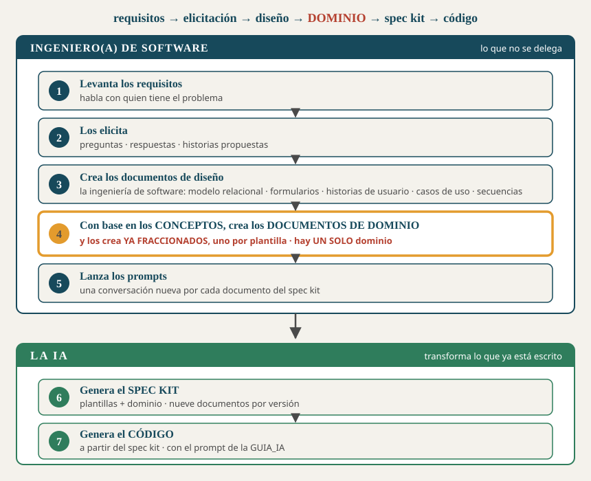

# Metodología: cómo se construye el dominio

> **Qué es este documento.** Cómo se construye la documentación de dominio:
> quién la escribe, de qué sale, **qué documentos debe haber**, en qué orden se
> escriben, cómo se decide la partición y **cómo se comprueba que está
> completa**.
>
> **Por qué existe.** Porque el dominio es **la entrada de la generación**: de él
> salen los spec kits, y de los spec kits sale el código. Un dominio mal
> construido no se nota al escribirlo — se nota tres pasos después, cuando el
> código no se parece a lo que se pidió.
>
> Versión 5.0 · 22 de octubre de 2026.

---

## 1. El recorrido

**requisitos → elicitación → diseño → DOMINIO → spec kit → código**



| # | Paso | Quién | Qué queda escrito |
|---|---|---|---|
| **1** | Levantar los requisitos | **ingeniero(a) de software** | Notas de la conversación con el usuario experto |
| **2** | Elicitarlos | **ingeniero(a) de software** | Las preguntas · las respuestas · las historias propuestas |
| **3** | Los documentos de diseño — la **ingeniería de software** | **ingeniero(a) de software** | Modelo relacional · formularios · historias de usuario · casos de uso · diagramas de secuencia |
| **4** | Los **documentos de dominio**, con base en los conceptos | **ingeniero(a) de software** | **El dominio: uno solo, fraccionado por plantilla** |
| **5** | Lanzar los prompts | **ingeniero(a) de software** | — |
| **6** | El **spec kit** | la IA | Nueve documentos por versión |
| **7** | El **código** | la IA | El sistema |

> **Los cinco primeros pasos son del ingeniero(a) de software, y son los cinco
> que no se pueden delegar.** Una IA no estuvo en la elicitación: no puede
> inventar lo que el usuario experto dijo, ni decidir el alcance de una versión,
> ni rediseñar un modelo de datos que ya se acordó. Lo que sí puede hacer —y es
> mucho— es **transformar** lo que ya está escrito.

---

## 2. Un solo dominio

> **No hay dos dominios.** El dominio es **uno**, y vive en un solo sitio:
> `docs/dominio/`.

Los documentos de diseño del paso 3 —el modelo relacional, los formularios, las
historias de usuario, los casos de uso, los diagramas de secuencia— **no son un
segundo dominio: son el insumo del paso 4.** Se consultan para escribir el
dominio, y lo que de ellos haga falta para generar **queda dentro de los
documentos de dominio**.

| | Qué es | Para qué sirve |
|---|---|---|
| La **elicitación** (paso 2) | el registro de lo que se preguntó y lo que contestaron | Es la **fuente**: cuando dos documentos se contradigan, aquí se vuelve |
| El **diseño** (paso 3) | el modelo, los formularios, las historias, las secuencias | Es el **insumo** del dominio |
| El **dominio** (paso 4) | los documentos que la IA recibe | Es **la entrada de la generación**, y el único que entra a los prompts |

---

## 3. Los documentos del dominio, uno por uno

**La tercera columna es la que manda**: si un documento no tiene lector, no es
entrada de la generación y el presupuesto de tokens no le aplica.

### Los que vienen de la elicitación

| Documento | Qué responde | Quién lo lee |
|---|---|---|
| `elicitacion/1_PREGUNTAS` | Qué hay que averiguar — escrito **antes** de la reunión | nadie: es **fuente** |
| `elicitacion/2_RESPUESTAS` | Qué contestó el usuario experto, **con sus palabras** | nadie: es **fuente** |
| `elicitacion/3_HISTORIAS_PROPUESTAS` | Qué historias salen de esas respuestas, incluidas las que **no se construyen** | nadie directamente |
| `REGLAS_DE_NEGOCIO` | **Qué no puede dejar de ser cierto**, y **quién lo defiende** | el `2_spec` |
| `GLOSARIO` | Qué significa cada término del negocio | el `6_contracts` |

> **`REGLAS_DE_NEGOCIO` lleva una columna que decide si el documento sirve:
> «quién la defiende».** Una regla que nadie defiende es un deseo — y la columna
> obliga a decirlo cuando la respuesta es «nadie».

### Los que vienen del diseño

| Documento | Qué responde | Quién lo lee |
|---|---|---|
| `DISENO_BD` | El modelo en sus etapas —conceptual, lógico, físico— **y por qué quedó así** | el `5_data_model` |
| `DATOS_DE_PRUEBA` | Qué filas se siembran, y **de dónde salió cada una** | el `5_data_model` y el `7_quickstart` |
| `RF_V1` … `RF_Vn` | **Qué hace el sistema** en esa versión, y dónde se comprueba | el `2_spec`, el `6_contracts` y el `9_checklist` |
| `REQUISITOS_NO_FUNCIONALES` | Qué tiene que **ser**, con **cómo se mide** cada cosa | el `1_constitution` y el `3_plan` |
| `MANUAL_DE_MARCA` | La identidad visual, con los **contrastes calculados** | el `2_spec` y el `3_plan` de la versión que la aplica |

### Los que vienen de los conceptos y de las decisiones

| Documento | Qué responde | Quién lo lee |
|---|---|---|
| `ARQUITECTURA_CAPAS` | Qué puede y **qué tiene prohibido** cada capa · dónde vive cada regla | el `1_constitution` |
| `ARQUITECTURA_PROCESOS` | Cuántas unidades desplegables hay y **cómo se hablan** | el `3_plan` |
| `CODIGOS_DE_ESTADO` | Qué código responde cada fallo, y **quién lo decide** | el `1_constitution`, el `6_contracts` y el `7_quickstart` |
| `ERRORES_DEL_MOTOR` | Cómo se traduce a HTTP lo que dice la base de datos | el `6_contracts` y el `7_quickstart` |
| `FUENTES_PROCEDENCIA` | De dónde salió el esquema, y **por qué ninguna IA lo genera** | el `1_constitution` |
| `FUENTES_AUTORIDAD` | **Qué manda sobre qué** cuando dos documentos se contradicen | el `4_research` |
| `PENDIENTES` | Qué se decidió **NO** hacer, con su razón | el `4_research` |

### Los del plan

| Documento | Qué responde | Quién lo lee |
|---|---|---|
| `PLAN_V1` … `PLAN_Vn` | **El alcance de esa versión**: qué entra y qué se deja | el `2_spec`, el `8_tasks` y el `9_checklist` |
| `PLAN_DE_TRABAJO` | Quién hace qué, en qué rama, y quién escribe cada documento | el `8_tasks` |

### Los que NO alimentan ninguna plantilla

| Documento | Qué responde | Por qué está |
|---|---|---|
| `MAPA_DE_DOCUMENTOS` | **Qué documento alimenta a qué plantilla** | Es el mapa, y **se escribe primero** |
| `CRONOGRAMA` | Qué se hizo y cuándo | Se saca de `git log`, no se redacta de memoria |
| `SUSTENTACION_DEL_CODIGO` | Las preguntas que se van a hacer sobre el código | Es material para la sustentación |

> **A estos tres no les aplica el presupuesto de tokens**, porque no entran a
> ninguna conversación de generación. Confundirlos con los otros lleva a partir
> documentos que no hacía falta partir.

---

## 4. En qué orden se escriben

El orden **no es alfabético ni por importancia: es por dependencia.** Cada paso
necesita el anterior.

| # | Qué se escribe | Por qué va aquí |
|---|---|---|
| **0** | `MAPA_DE_DOCUMENTOS` | **Decide cuántos documentos hay y dónde se corta cada uno.** Antes de escribir una línea |
| **1** | `elicitacion/` — las tres | Es la fuente. Sin ella, todo lo demás se inventa |
| **2** | `REGLAS_DE_NEGOCIO` · `GLOSARIO` | Salen **directo** de las respuestas |
| **3** | `DISENO_BD` · `DATOS_DE_PRUEBA` | Describen el modelo del paso 3 del método |
| **4** | `RF_Vn` · `REQUISITOS_NO_FUNCIONALES` | Qué hace y qué debe ser: ya se sabe sobre qué datos |
| **5** | `ARQUITECTURA_CAPAS` · `ARQUITECTURA_PROCESOS` | Dónde va cada cosa: necesita saber qué cosas hay |
| **6** | `CODIGOS_DE_ESTADO` · `ERRORES_DEL_MOTOR` | Qué responde ante cada fallo: necesita las capas y las reglas |
| **7** | `FUENTES_PROCEDENCIA` · `FUENTES_AUTORIDAD` · `PENDIENTES` | El acta de lo decidido: se escriben cuando ya hay decisiones |
| **8** | `PLAN_Vn` · `PLAN_DE_TRABAJO` | El alcance y el reparto, versión por versión |
| **9** | `CRONOGRAMA` · `SUSTENTACION_DEL_CODIGO` | Al final, y **se actualizan**: hablan de lo que ya pasó |

> **El paso 0 es el que más se salta, y el que más cuesta.** Escribir el mapa al
> final convierte la partición en una corrección; escribirlo primero la
> convierte en una decisión.

---

## 5. El dominio nace fraccionado

Los documentos de dominio **no son un texto que después se le pasa a una IA.
Son la entrada de la generación.** Y por eso se escriben **con la forma con la
que se le van a entregar**.

> **La regla:** los documentos de dominio se crean **pensando en las
> plantillas**. Cada plantilla se alimenta de dos o tres documentos de dominio,
> y **esos documentos tienen que caber enteros en esa conversación.**

### Los tres casos, y qué se hace en cada uno

| Si el documento de dominio… | Entonces… | Por qué |
|---|---|---|
| alimenta **una sola** plantilla | va **entero**, en un solo archivo | No compite con nada. El tamaño aquí no importa |
| alimenta **dos o más** plantillas, y cada una usa **una parte distinta** | **son dos documentos**, y nacen así | Si no, una de las dos conversaciones recibe la parte que no le sirve |
| crece **una sección por versión** | **nace uno por versión** | La conversación de la v1 no tiene nada que hacer con la sección de la v4 |

> **El criterio NO es el tamaño: es cuántos lectores tiene.** Un documento de
> nueve mil caracteres con un solo lector se queda entero. Uno de seis mil con
> dos lectores que usan partes distintas, se parte.

### Y por qué se decide desde el concepto, no después

Si uno escribe el documento completo y luego recorta el pedazo que cabía, **el
recorte pierde el contexto que tenía alrededor** — y lo pierde justo cuando la
IA más lo necesita. La tabla sale sin la explicación que la precedía; el dato,
sin la razón que lo justificaba.

> **Fraccionar es una decisión de diseño, no una corrección.** Y se toma cuando
> todavía no hay nada escrito, que es cuando es gratis.

---

## 6. El presupuesto, en números

| | Presupuesto |
|---|---|
| Una conversación de generación | **~8.000 tokens** de entrada |
| La plantilla | ~1.500 tokens |
| Los documentos de dominio de esa conversación | ~6.000 tokens |
| **Entonces cada documento de dominio** | **~8.000 caracteres (~2.200 tokens)** |

**Por qué 8.000 tokens y no más.** Cabe mucho más —una conversación aguanta
cincuenta mil—, pero **la atención se reparte**: cuando el material es largo,
lo que se pidió al final sale peor que lo que se pidió al principio.

**Y la cuenta de caracteres a tokens:** en castellano, con tablas y Markdown,
**3,6 caracteres por token**. Medido en este repositorio, no estimado.

---

## 7. El mapa: qué documento de dominio alimenta a qué plantilla

Ésta es la tabla que decide la partición. **Se escribe primero.**

| Plantilla del spec kit | La alimentan |
|---|---|
| `1_constitution` | `ARQUITECTURA_CAPAS` · `REQUISITOS_NO_FUNCIONALES` · `CODIGOS_DE_ESTADO` · `FUENTES_PROCEDENCIA` |
| `2_spec` | `RF_Vn` · `REGLAS_DE_NEGOCIO` · `PLAN_Vn` |
| `3_plan` | `ARQUITECTURA_PROCESOS` · `REQUISITOS_NO_FUNCIONALES` |
| `4_research` | `FUENTES_AUTORIDAD` · `PENDIENTES` |
| `5_data_model` | `DISENO_BD` · `DATOS_DE_PRUEBA` |
| `6_contracts` | `RF_Vn` · `CODIGOS_DE_ESTADO` · `ERRORES_DEL_MOTOR` · `GLOSARIO` |
| `7_quickstart` | `DATOS_DE_PRUEBA` · `CODIGOS_DE_ESTADO` |
| `8_tasks` | `PLAN_Vn` · `PLAN_DE_TRABAJO` |
| `9_checklist` | `PLAN_Vn` · `RF_Vn` |
| `GUIA_IAn` | — **no se genera: se arma** |

---

## 8. Cómo se comprueba que el dominio está completo

Cuatro comprobaciones, y las cuatro se pueden correr.

### 1 · Nada fuera del dominio

> **Si para generar un documento del spec kit hay que abrir algo que no esté en
> `docs/dominio/`, el dominio está incompleto.**

Es la prueba más dura y la que más defectos encuentra. No significa que falte
material: significa que **está mal cortado**, o que vive en el sitio
equivocado.

### 2 · Ningún documento sin lector, y ningún lector sin documento

```powershell
# Cada documento de dominio tiene que aparecer en el mapa (§7), y cada
# plantilla tiene que tener sus documentos. Lo que sobre o falte, se ve aquí.
Get-ChildItem docs\dominio\*.md | Select-Object -ExpandProperty Name
```

| Qué se busca | Qué significa si aparece |
|---|---|
| Un documento que **no está en el mapa** | O no es entrada de la generación —y hay que decirlo— o al mapa le falta una fila |
| Una plantilla **sin documentos** | Esa plantilla se va a llenar con lo que la IA suponga |

### 3 · Cada fase cabe en su presupuesto

```powershell
# El peso de los documentos de una fase, en caracteres
(Get-Item docs\dominio\RF_V1.md, docs\dominio\REGLAS_DE_NEGOCIO.md,
          docs\dominio\PLAN_V1.md | Measure-Object Length -Sum).Sum
```

Dividido por **3,6** da los tokens. Si una fase pasa de ~8.000, hay un
documento mal cortado — y el §5 dice cuál de los tres casos es.

### 4 · Ninguna aclaración pendiente escondida

```powershell
Select-String -Path docs\dominio\*.md -Pattern "NECESITA ACLARACIÓN"
```

Un `[NECESITA ACLARACIÓN]` en el dominio es una pregunta para la próxima
reunión. **Lo que no se vale es que esté y nadie lo sepa.**

---

## 9. Lo que NO va en el dominio

| No va | Dónde va |
|---|---|
| El esquema SQL | `db/`. El dominio **lo describe**, no lo contiene |
| El código | `api_facturas/`, `front_*` |
| Los requisitos de una versión que todavía no se planeó | En ninguna parte. Se escribe cuando se planea |
| Lo que la IA debe hacer | Las plantillas y el generador |
| Una decisión sin su razón | **En ninguna parte.** Una decisión sin razón no se puede revisar después |

> **Y la que más se cuela: el dominio DESCRIBE, no DECIDE.** Lo que decide es el
> `2_spec` de cada versión. Si alguien cambia el código porque un documento de
> dominio dice otra cosa, lo hizo al revés — ese documento debía actualizarse.

---

## 10. Lo medido en este repositorio

Al reescribir el dominio con esta metodología, el 22 de octubre de 2026:

| Documento | Antes | Después | Criterio |
|---|---|---|---|
| `REQUISITOS_FUNCIONALES` | 14.503 | índice 7.148 + **4 archivos** de 2.888 a 4.057 | **por versión**: tres plantillas, cada una solo una |
| `ARQUITECTURA` | 12.809 | índice 2.008 + `_CAPAS` 7.837 + `_PROCESOS` 6.573 | **dos lectores** |
| `FUENTES` | 9.801 | índice 1.602 + `_PROCEDENCIA` 4.369 + `_AUTORIDAD` 6.744 | **dos lectores** |
| `POLITICA_DE_ERRORES` | 7.449 | índice 1.848 + `CODIGOS_DE_ESTADO` 6.343 + `ERRORES_DEL_MOTOR` 3.437 | **tres lectores** |

**Y los que NO se partieron, por el mismo criterio:** `DISENO_BD` (10.157),
`PLAN_DE_TRABAJO` (11.604), los cuatro `PLAN_Vn`, `GLOSARIO` (8.741) y
`REGLAS_DE_NEGOCIO` (8.639) tienen **un solo lector** cada uno y sus fases
entran. `SUSTENTACION_DEL_CODIGO` (17.959) y `CRONOGRAMA` **no alimentan
ninguna plantilla**.

**Los cuatro originales siguen existiendo como índice**, así que ningún enlace
se rompió.

### Las nueve fases, medidas después

| Fase | Produce | Tokens |
|---|---|---|
| 0 | `1_constitution` | 8.442 |
| 1 | `2_spec` | 8.433 |
| 2 | `3_plan` | 9.181 |
| 3 | `4_research` | 8.335 |
| 4 | `5_data_model` | **5.463** |
| 5 | `6_contracts` | 7.288 |
| 6 | `7_quickstart` | 6.139 |
| 7 | `8_tasks` | 8.930 |
| 8 | `9_checklist` | 6.652 |

> **La más cargada es la 2, y no es culpa del dominio:** recibe el `2_spec` de
> la v1 **ya generado**, que son 15.981 caracteres. Por eso las fases 7 y 8
> reciben solo **§2 y §5** de ese documento y no el entero.

---

## 11. Lo que cambia respecto de cómo se hacía antes

| | Antes | Con esta metodología |
|---|---|---|
| **El mapa de documentos** | un índice, escrito al final | **la primera decisión**, antes de escribir |
| **Fraccionar** | una corrección, cuando no cupo | una **decisión de diseño**, desde el concepto |
| **El tamaño** | no se mencionaba | **~8.000 caracteres**; si no cabe, nace partido |
| **El criterio para partir** | — | **cuántos lectores tiene**, no cuántos caracteres |
| **Los recortes al pegar** | se hacían | **no existen**: si hay que recortar, el documento está mal cortado |
| **Dónde vive el dominio** | — | **un solo sitio**: `docs/dominio/` |
| **El orden de escritura** | por conveniencia | **por dependencia** (§4) |
