# Verificar el control de acceso con Postman

> Aquí **no entra el front**. Postman hace las peticiones y se sigue, método por
> método, lo que hace la **API** con cada una. Es la misma prueba de
> [VERIFICAR_CONTROL_DE_ACCESO_SWAGGER.md](VERIFICAR_CONTROL_DE_ACCESO_SWAGGER.md),
> con otra herramienta.
>
> | Usuario | Contraseña | `GET /api/usuario` debe dar |
> |---|---|---|
> | `admin@correo.com` | `admin123` | `200` |
> | `vendedor1@correo.com` | `vendedor123` | `403` |
> | (sin token) | | `401` |

---

# Parte 1. Cómo se genera el token

## Paso 1. Postman: `POST /api/sesion`

Petición nueva → método `POST` → URL `http://localhost:8035/api/sesion` →
pestaña **Body** → **raw** → **JSON**:

```json
{
  "email": "admin@correo.com",
  "contrasena": "admin123"
}
```

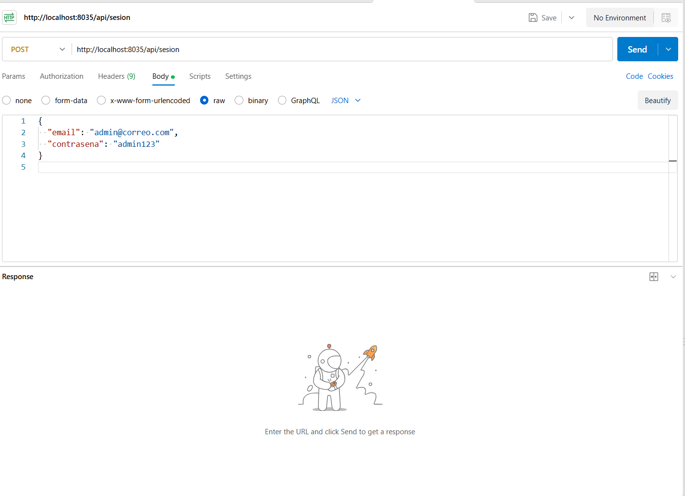

**Qué muestra esta pantalla.** La petición armada en Postman: método `POST`, la URL de la API y, en la pestaña **Body**, el JSON con el correo y la contraseña del administrador. Abajo, **Response** está vacío porque todavía no se ha oprimido **Send**. No hay nada en **Authorization**: para iniciar sesión no hace falta token.

Al oprimir **Send**, la petición llega a la API.

**→ Sigue en:** `api_facturas/Controllers/SesionController.cs`, método `Iniciar`.

## Paso 2. `SesionController.cs` → método `Iniciar`

Archivo: [`api_facturas/Controllers/SesionController.cs`](../../api_facturas/Controllers/SesionController.cs), línea 98

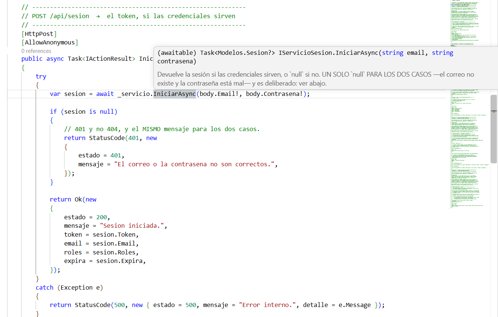

**Qué hace este código.** El algoritmo de `Iniciar`: (1) recibe el correo y la contraseña en `body`, sin pedir token (`[AllowAnonymous]`), porque quien inicia sesión todavía no tiene uno; (2) le pasa los dos datos al servicio, sin revisar nada él mismo; (3) si el servicio devuelve `null`, responde `401` con un mensaje que no dice si falló el correo o la contraseña; (4) si devuelve una sesión, responde `200` con el token, el correo, los roles y la fecha de vencimiento.

Recibe el JSON de Postman en `body`. `[AllowAnonymous]`: no pide token, porque
todavía no hay uno.

La línea que sigue el flujo es la **102**:

```csharp
var sesion = await _servicio.IniciarAsync(body.Email!, body.Contrasena!);
```

**→ Sigue en:** `api_facturas/Servicios/ServicioSesion.cs`, método `IniciarAsync`.

## Paso 3. `ServicioSesion.cs` → método `IniciarAsync`

Archivo: [`api_facturas/Servicios/ServicioSesion.cs`](../../api_facturas/Servicios/ServicioSesion.cs), línea 48

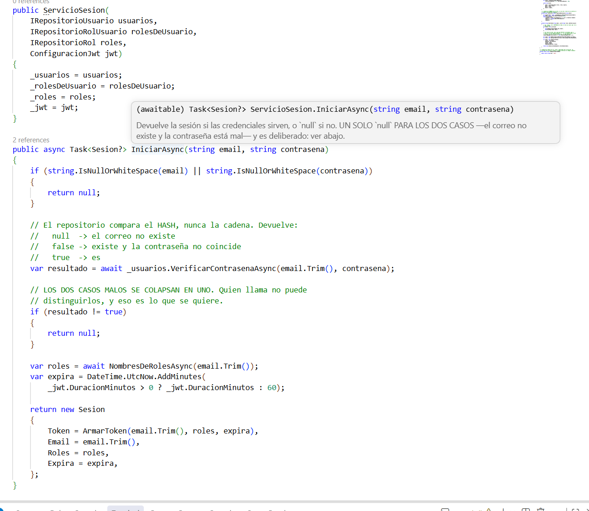

**Qué hace este código.** El algoritmo de `IniciarAsync` de la API: (1) si falta el correo o la contraseña, devuelve `null`; (2) le pide al repositorio que compare la contraseña; (3) si no coincide o el correo no existe, devuelve `null` (los dos casos iguales, para no revelar cuál fue); (4) busca los nombres de los roles; (5) calcula el vencimiento (los minutos configurados, o 60); (6) arma el token; (7) devuelve token, correo, roles y vencimiento en un objeto `Sesion`.

Hace tres llamados, en este orden:

| Línea | Llamado | Para qué |
|---|---|---|
| **59** | `_usuarios.VerificarContrasenaAsync(...)` | ¿La contraseña es correcta? |
| **68** | `NombresDeRolesAsync(...)` | ¿Qué roles tiene? |
| **74** | `ArmarToken(...)` | **Crear el token** |

**→ Sigue en:** `api_facturas/Repositorios/RepositorioUsuarioSqlServer.cs`, método `VerificarContrasenaAsync`.

## Paso 4. `RepositorioUsuarioSqlServer.cs` → método `VerificarContrasenaAsync`

Archivo: [`api_facturas/Repositorios/RepositorioUsuarioSqlServer.cs`](../../api_facturas/Repositorios/RepositorioUsuarioSqlServer.cs), línea 72

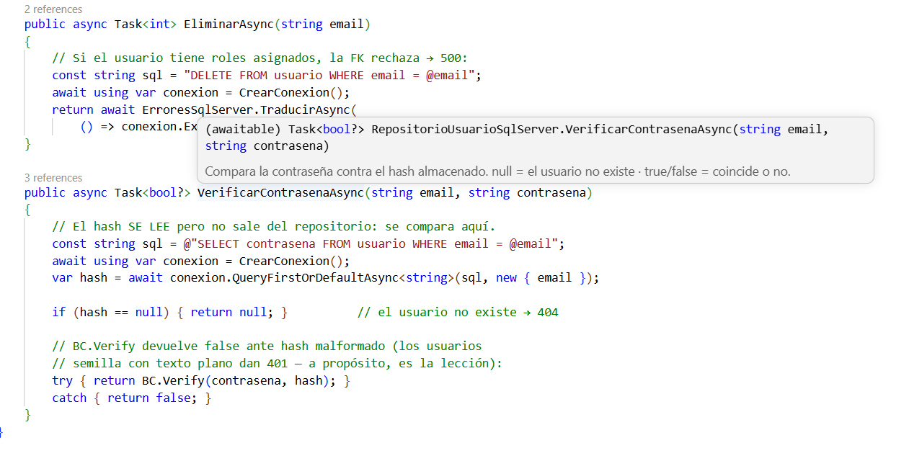

**Qué hace este código.** El algoritmo de `VerificarContrasenaAsync`: (1) consulta en la tabla `usuario` el hash guardado para ese correo; (2) si no hay fila, el correo no existe y devuelve `null`; (3) si la hay, `BC.Verify` calcula el hash de la contraseña escrita con el mismo salt y costo del hash guardado, y compara: iguales → `true`, distintos → `false`; (4) si lo guardado no es un hash de bcrypt, devuelve `false`.

1. `SELECT contrasena FROM usuario WHERE email = @email` → el **hash** guardado.
2. Si no hay → `null` (el correo no existe).
3. `BC.Verify("admin123", hash)` → bcrypt saca el salt del hash guardado, calcula
   el hash de `admin123` con ese salt y compara → `true`.

**→ Vuelve a:** `IniciarAsync`, línea 68 → `NombresDeRolesAsync`.

## Paso 5. `ServicioSesion.cs` → método `NombresDeRolesAsync`

Archivo: [`api_facturas/Servicios/ServicioSesion.cs`](../../api_facturas/Servicios/ServicioSesion.cs), línea 111

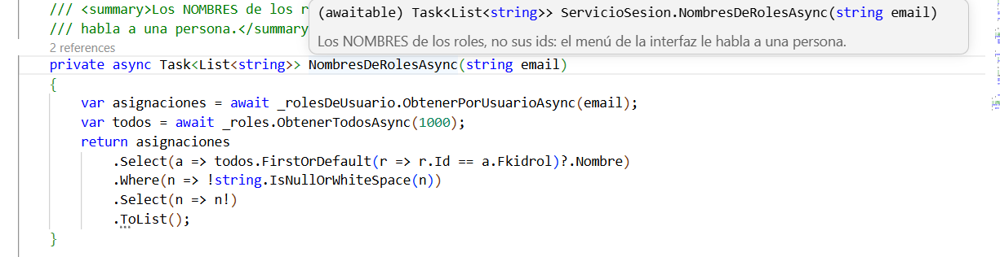

**Qué hace este código.** El algoritmo de `NombresDeRolesAsync`: (1) trae los roles asignados a ese correo, que vienen solo como números (`fkidrol`); (2) trae todos los roles con su número y su nombre; (3) a cada número asignado le busca su nombre; (4) descarta los que no encontró; (5) devuelve la lista de nombres.

| Llamado | Tabla | Para el administrador |
|---|---|---|
| `_rolesDeUsuario.ObtenerPorUsuarioAsync(email)` | `rol_usuario` | id `1` |
| `_roles.ObtenerTodosAsync(1000)` | `rol` | `1` = Administrador |

Resultado: `["Administrador"]`.

**→ Vuelve a:** `IniciarAsync`, línea 74 → `ArmarToken`.

## Paso 6. `ServicioSesion.cs` → método `ArmarToken` — aquí se crea el token

Archivo: [`api_facturas/Servicios/ServicioSesion.cs`](../../api_facturas/Servicios/ServicioSesion.cs), línea 122

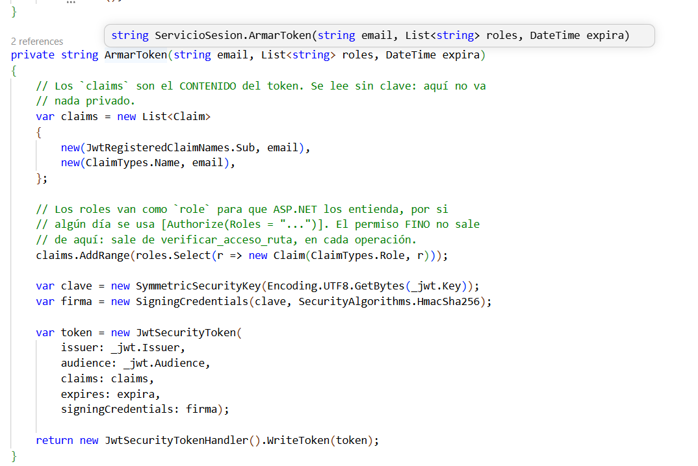

**Qué hace este código.** El algoritmo de `ArmarToken`: (1) arma los *claims*, es decir lo que va dentro del token: el correo dos veces (`sub` y `name`) y un `role` por cada rol; (2) crea la llave a partir de la clave secreta de la API; (3) con esa llave prepara la firma `HmacSha256`; (4) construye el token con emisor, audiencia, claims, vencimiento y firma; (5) lo convierte en el texto `eyJ...` y lo devuelve.

| Parte | Código | Para el administrador |
|---|---|---|
| **Contenido** (claims) | `Sub`, `Name`, `Role` | `admin@correo.com`, `Administrador` |
| **Firma** | `_jwt.Key` + `HmacSha256` | con la clave secreta de la API |
| **Vencimiento** | `expires: expira` | una hora después |
| **Texto final** | `WriteToken(token)` | `eyJhbGciOiJIUzI1NiIs...` |

**→ Vuelve a:** `IniciarAsync` → arma la `Sesion` → `SesionController.Iniciar` → `return Ok(...)`.

## Paso 7. Postman: la respuesta `200` con el token

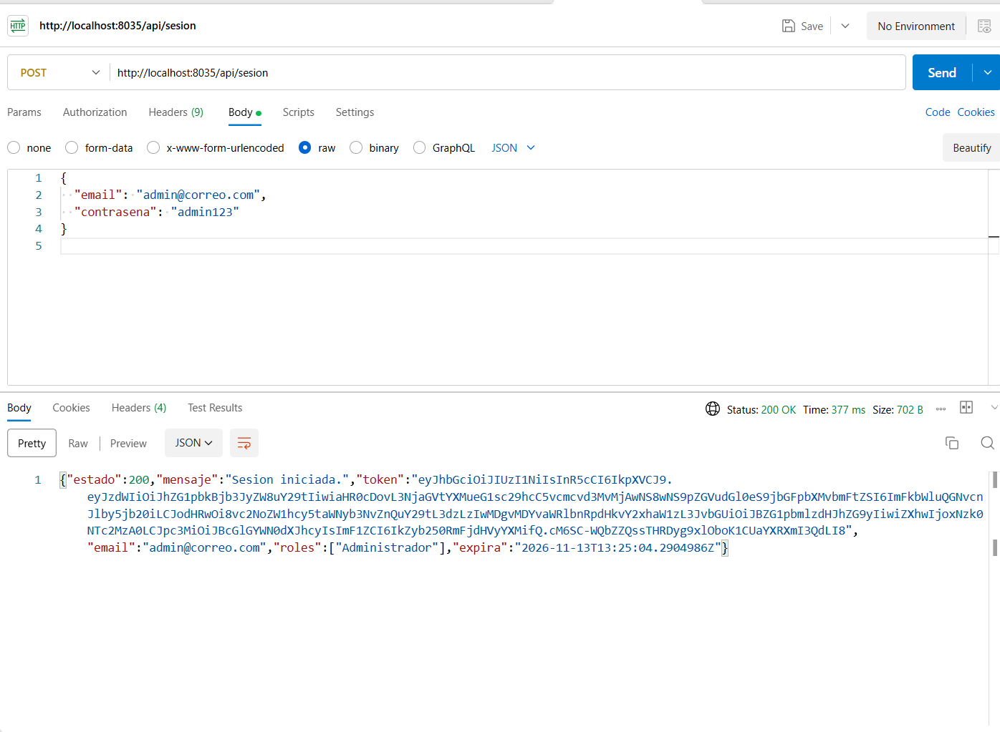

**Qué muestra esta pantalla.** La respuesta de la API después de **Send**. Arriba a la derecha, **Status: 200 OK** y el tiempo que tardó. En **Body**, el JSON de respuesta: «Sesion iniciada.», el token (el texto largo `eyJ...`), el correo, los roles y la fecha de vencimiento.

| Campo | Valor | Viene de |
|---|---|---|
| Status | `200 OK` | `SesionController.Iniciar`, `return Ok(...)` |
| `token` | `eyJhbGciOiJIUzI1NiIs...` | `ArmarToken` (paso 6) |
| `roles` | `["Administrador"]` | `NombresDeRolesAsync` (paso 5) |
| `expira` | una hora después | `IniciarAsync` (paso 3) |

Copiar el valor de `token`, **sin las comillas**: se usa en el paso siguiente.

---

# Parte 2. Usar el token

## Paso 8. Postman: darle el token en **Authorization**

Método `GET` → URL `http://localhost:8035/api/usuario` → pestaña
**Authorization** → **Type: Bearer Token** → pegar el token en **Token**
(sin comillas y sin escribir `Bearer`).

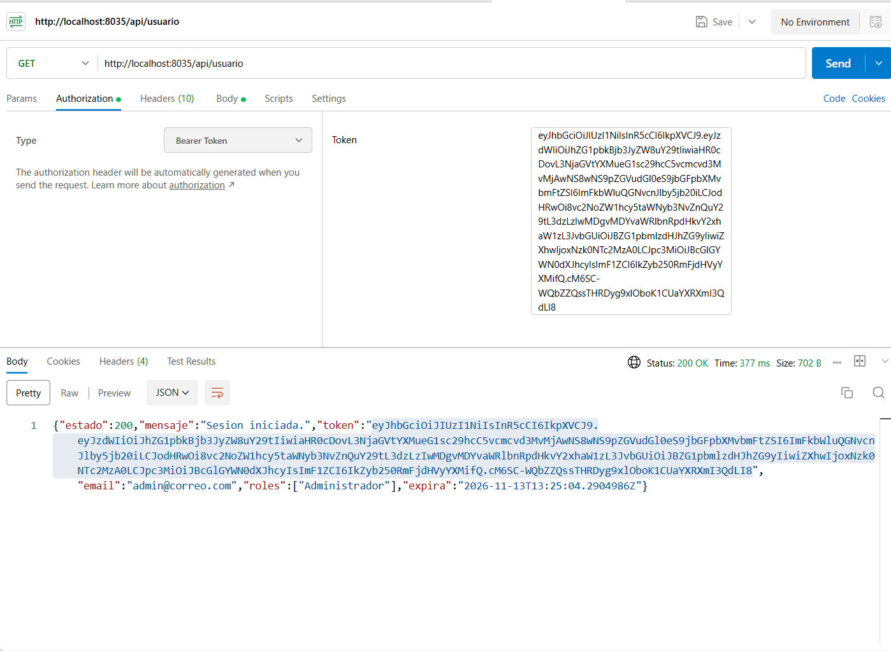

**Qué muestra esta pantalla.** La pestaña **Authorization** de la petición `GET /api/usuario`, con el tipo **Bearer Token** y el token del administrador pegado en la casilla de la derecha. Postman avisa que la cabecera se arma sola al enviar: agregará `Authorization: Bearer <token>` a la petición. Abajo todavía se ve la respuesta anterior, la del inicio de sesión.

## Paso 9. Postman: `GET /api/usuario` como administrador

Con el token puesto en **Authorization** (paso 8) y **Body** en **none** → **Send**.
Postman agrega sola la cabecera `Authorization: Bearer eyJ...` a la petición.

**→ Sigue en:** `api_facturas/Controllers/UsuarioController.cs`.

## Paso 10. `UsuarioController.cs` → los atributos de la clase

Archivo: [`api_facturas/Controllers/UsuarioController.cs`](../../api_facturas/Controllers/UsuarioController.cs)

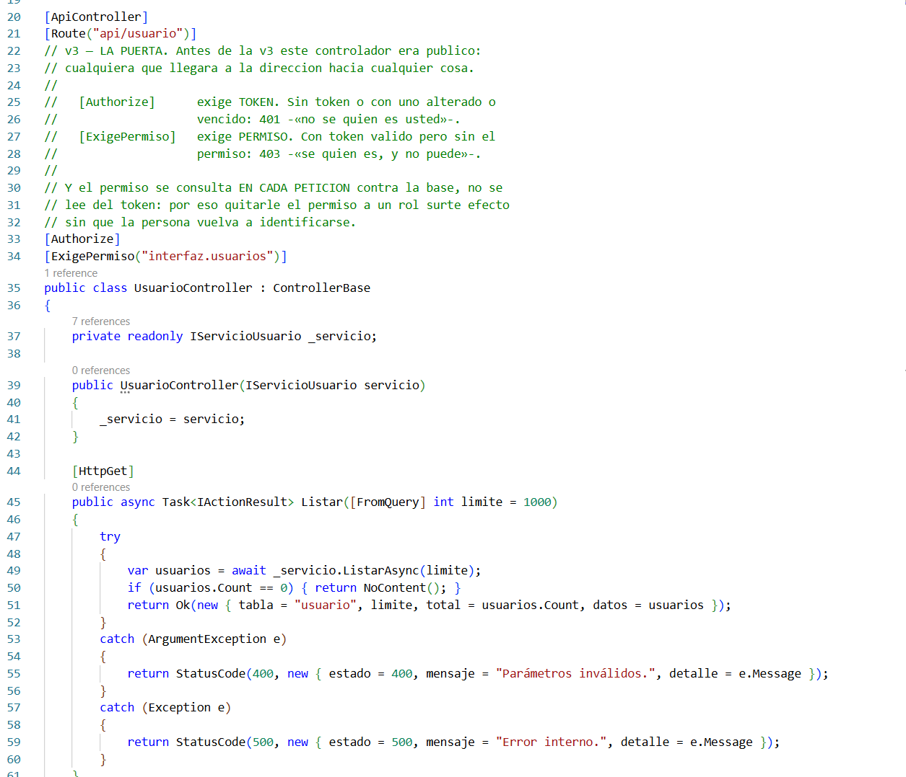

**Qué hace este código.** Lo que hace este controlador: sobre la clase están `[Authorize]`, que exige un token válido, y `[ExigePermiso("interfaz.usuarios")]`, que exige que el rol tenga esa ruta. Los dos corren antes que cualquier método. `Listar` solo pide la lista al servicio y la devuelve (`200`, o `204` si está vacía); no tiene ninguna línea de control de acceso.

Antes de entrar a `Listar` (línea 45) corren los dos atributos:

| Línea | Atributo | Administrador |
|---|---|---|
| **33** | `[Authorize]`: ¿token válido? | Sí: firma correcta y no ha vencido. Saca `admin@correo.com` del token. |
| **34** | `[ExigePermiso("interfaz.usuarios")]` | Se revisa en el paso 11. |

**→ Sigue en:** `api_facturas/Autorizacion/ExigePermisoAttribute.cs`, método `OnAuthorizationAsync`.

## Paso 11. `ExigePermisoAttribute.cs` → método `OnAuthorizationAsync`

Archivo: [`api_facturas/Autorizacion/ExigePermisoAttribute.cs`](../../api_facturas/Autorizacion/ExigePermisoAttribute.cs), línea 46

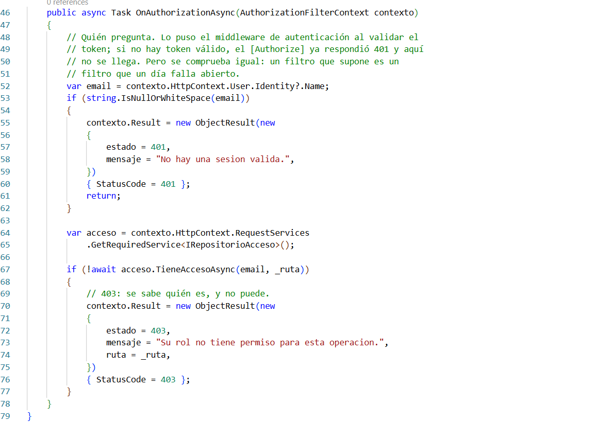

**Qué hace este código.** El algoritmo de `OnAuthorizationAsync`: (1) toma el correo del token; (2) si no hay correo, responde `401` y corta; (3) consigue el repositorio de acceso; (4) le pregunta si ese correo tiene la ruta del atributo; (5) si la respuesta es no, responde `403` con la ruta que faltó y corta, así que el método del controlador no corre; (6) si es sí, no hace nada y la petición sigue.

Línea **67**: `TieneAccesoAsync("admin@correo.com", "interfaz.usuarios")`.
Si responde `false` → `403`. Si responde `true` → deja pasar a `Listar`.

**→ Sigue en:** `api_facturas/Repositorios/RepositorioAccesoSqlServer.cs`, método `TieneAccesoAsync`.

## Paso 12. `RepositorioAccesoSqlServer.cs` → método `TieneAccesoAsync`

Archivo: [`api_facturas/Repositorios/RepositorioAccesoSqlServer.cs`](../../api_facturas/Repositorios/RepositorioAccesoSqlServer.cs), línea 35

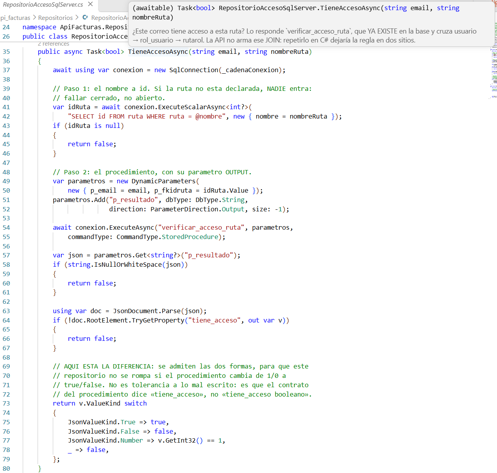

**Qué hace este código.** El algoritmo de `TieneAccesoAsync`: (1) busca el número de la ruta por su nombre; (2) si la ruta no existe, devuelve `false`, y nadie entra; (3) ejecuta el procedimiento `verificar_acceso_ruta` con el correo y ese número; (4) lee el JSON que el procedimiento deja en `p_resultado`; (5) si `tiene_acceso` vale `1` o `true`, devuelve `true`; cualquier otra cosa, `false`.

1. `"interfaz.usuarios"` → id `2`.
2. Ejecuta el procedimiento `verificar_acceso_ruta("admin@correo.com", 2)`.
3. Lee `tiene_acceso` del JSON que devuelve.

**→ Sigue en:** `db/bdfacturas.sql`, procedimiento `verificar_acceso_ruta`.

## Paso 13. `bdfacturas.sql` → procedimiento `verificar_acceso_ruta`

Archivo: [`db/bdfacturas.sql`](../../db/bdfacturas.sql), línea 1790

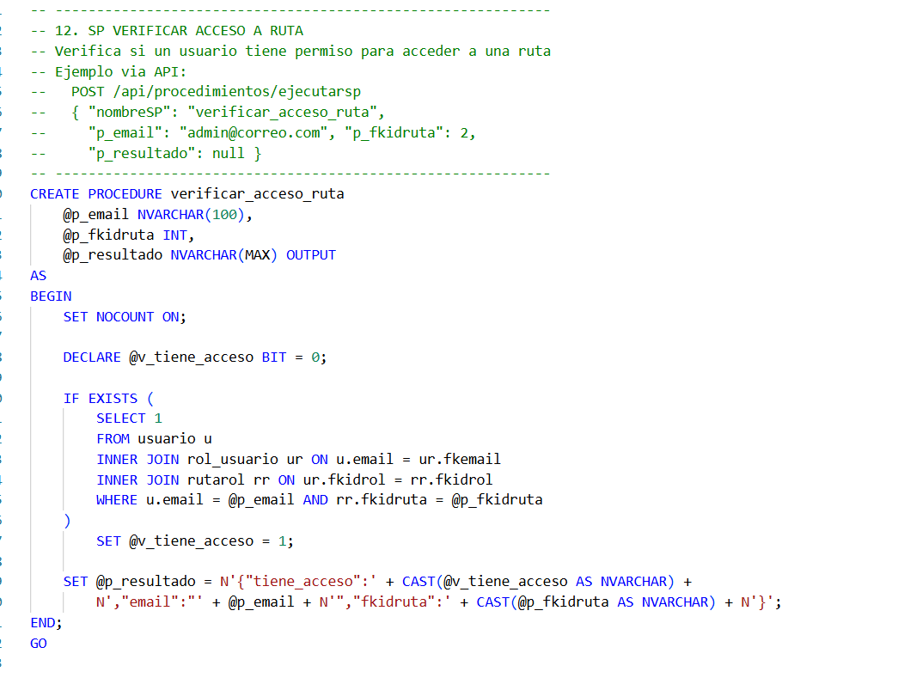

**Qué hace este código.** El algoritmo de `verificar_acceso_ruta`: (1) empieza con `@v_tiene_acceso = 0`, es decir sin acceso; (2) busca si existe al menos una fila que una ese correo, por `rol_usuario`, con un rol que en `rutarol` tenga esa ruta; (3) si existe, cambia a `1`; (4) devuelve `{"tiene_acceso": 0 o 1, "email": ..., "fkidruta": ...}` en `@p_resultado`.

¿Algún rol de `admin@correo.com` tiene la ruta `2`?
Su rol es `1` (Administrador), y `rutarol` tiene `(2, 1)` → **sí** → `tiene_acceso: 1`.

**→ Vuelve:** `TieneAccesoAsync` → `true` → `ExigePermiso` deja pasar →
`UsuarioController.Listar` corre → `200`.

## Paso 14. Postman: la respuesta `200`

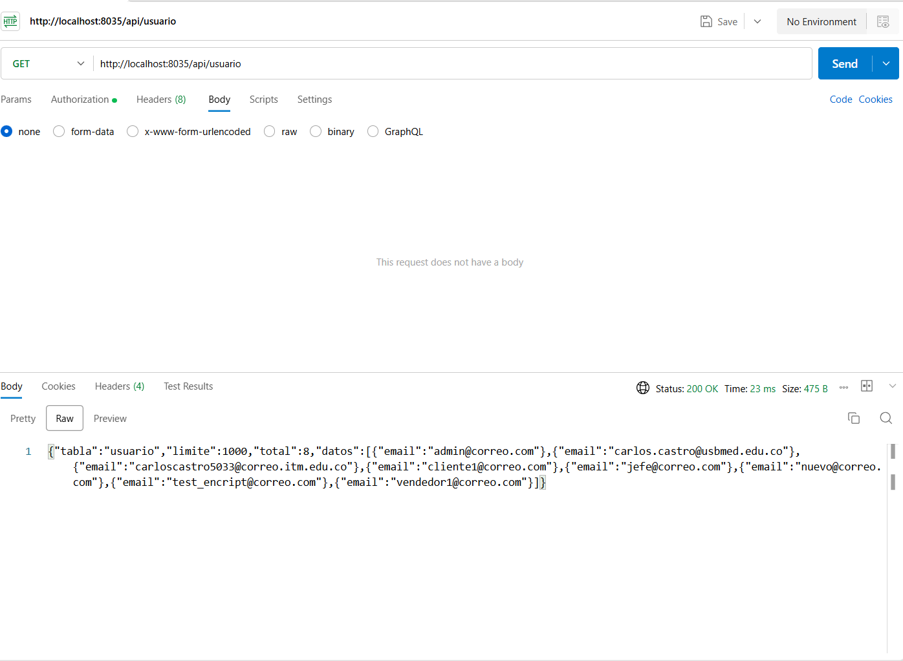

**Qué muestra esta pantalla.** La petición `GET /api/usuario` con el token del administrador en **Authorization** (el punto verde) y sin cuerpo (**Body: none**). Abajo, **Status: 200 OK** y, en la vista **Raw**, el JSON con `"tabla":"usuario"`, `"total":8` y la lista de correos en `datos`: el administrador **sí** puede.

> Si el panel de respuesta sigue mostrando la respuesta anterior aunque el
> **Status** cambió, es la extensión de Postman en VS Code, que no redibuja
> mientras haya texto seleccionado en ese panel. Oprimir **Raw** lo obliga a
> pintar la respuesta nueva.

---

# Parte 3. El vendedor: mismo pedido, otra respuesta

## Paso 15. Postman: `POST /api/sesion` como vendedor

```json
{ "email": "vendedor1@correo.com", "contrasena": "vendedor123" }
```

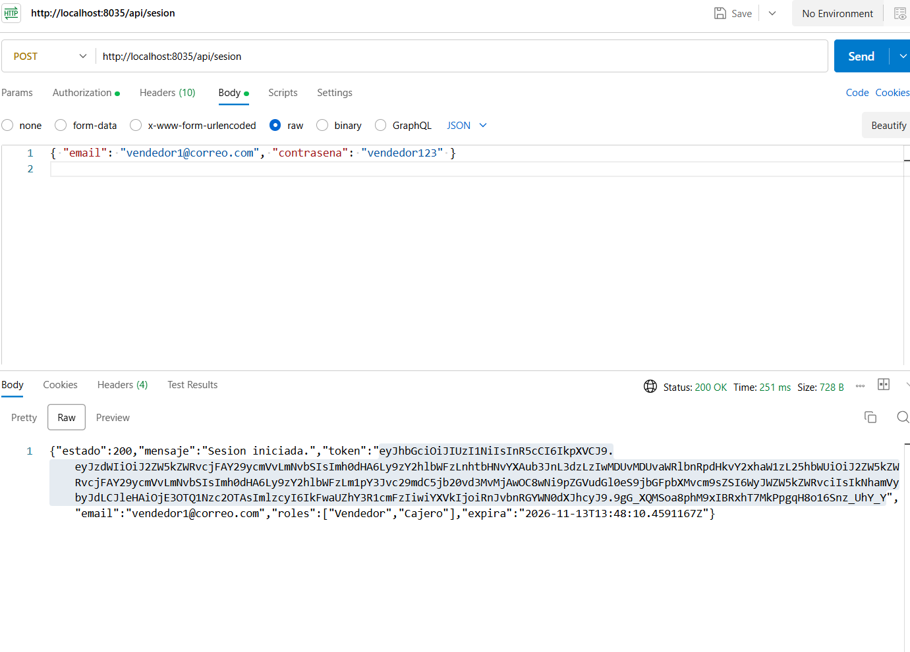

**Qué muestra esta pantalla.** La misma petición `POST /api/sesion`, ahora con el correo y la contraseña del vendedor en **Body**. La respuesta, en la vista **Raw**, es `200` con «Sesion iniciada.», un token distinto al del administrador y `"roles":["Vendedor","Cajero"]`. La respuesta pesa 728 B, más que la del administrador (702 B), porque el token lleva dos roles.

En la API pasa lo mismo que en los pasos 2 a 6; lo único distinto es lo que sale de la base:

| Paso | Administrador | Vendedor |
|---|---|---|
| 4. `VerificarContrasenaAsync` | `true` | `true` |
| 5. `NombresDeRolesAsync` | `["Administrador"]` | `["Vendedor", "Cajero"]` |
| 6. `ArmarToken` | token con `role = Administrador` | token con `role = Vendedor`, `role = Cajero` |

> **Authorization** tiene el punto verde: la petición también llevó el token del
> administrador. No importa: `POST /api/sesion` tiene `[AllowAnonymous]` y no lo mira.

## Paso 16. Postman: `GET /api/usuario` como vendedor → `403`

En **Authorization** → **Bearer Token**, cambiar el token del administrador por el
del vendedor → **Send**.

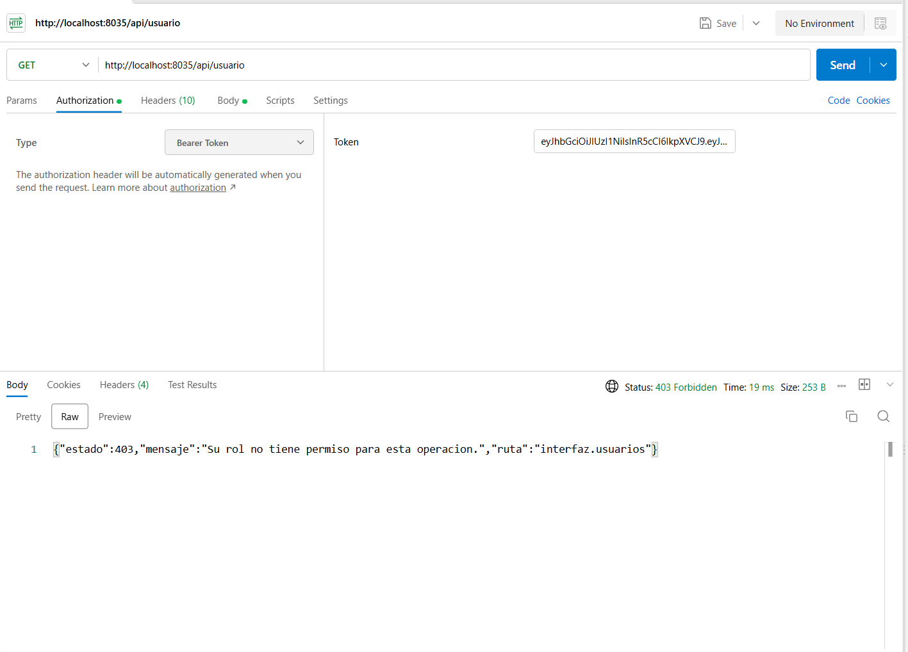

**Qué muestra esta pantalla.** La misma petición `GET /api/usuario`, ahora con el token del vendedor en **Authorization**. La respuesta es **403 Forbidden** con «Su rol no tiene permiso para esta operacion.» y la ruta que le faltó, `interfaz.usuarios`. El token es válido (no dio `401`): la API sabe quién es, pero su rol no tiene permiso.

En la API recorre **los mismos** pasos 10 a 13. Esta es la diferencia:

| Paso | Administrador | Vendedor |
|---|---|---|
| 10. `[Authorize]` | token válido ✔ | token válido ✔ |
| 12. `"interfaz.usuarios"` → id | `2` | `2` |
| 13. `verificar_acceso_ruta` | rol `1` tiene la ruta `2` → **`1`** | roles `2` y `3` no la tienen → **`0`** |
| ← `TieneAccesoAsync` | `true` | `false` |
| ← 11. `ExigePermiso` | deja pasar | **`403`**, línea 70 |
| `UsuarioController.Listar` | corre → `200` | **no corre** |

---

# Parte 4. Sin token

## Paso 17. Postman: `GET /api/usuario` sin token → `401`

En **Authorization**, sin token (o **Type: No Auth**) → **Send**.

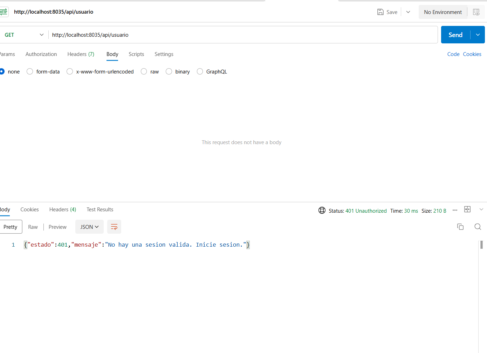

**Qué muestra esta pantalla.** La petición `GET /api/usuario` sin token: la pestaña **Authorization** no tiene el punto verde. La respuesta es **401 Unauthorized** con «No hay una sesion valida. Inicie sesion.»

Aquí la petición **no llega** ni a `ExigePermiso` ni a la base: se detiene en
`[Authorize]` (paso 10). El mensaje lo escribe
[`Program.cs`](../../api_facturas/Program.cs), línea 152 (`OnChallenge`).

---

## Resumen

| Prueba | Token | Se detiene en | Respuesta |
|---|---|---|---|
| Administrador | válido, `role = Administrador` | — llega a `Listar` | **`200`** |
| Vendedor | válido, `role = Vendedor, Cajero` | `ExigePermiso` (la base dice `0`) | **`403`** |
| Sin token | — | `[Authorize]` | **`401`** |

- **`401`**: «no sé quién es usted».
- **`403`**: «sé quién es, y no puede».
